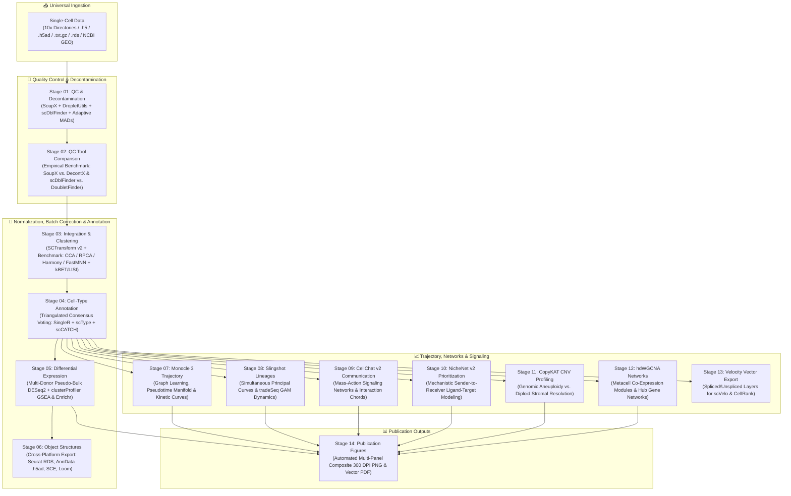
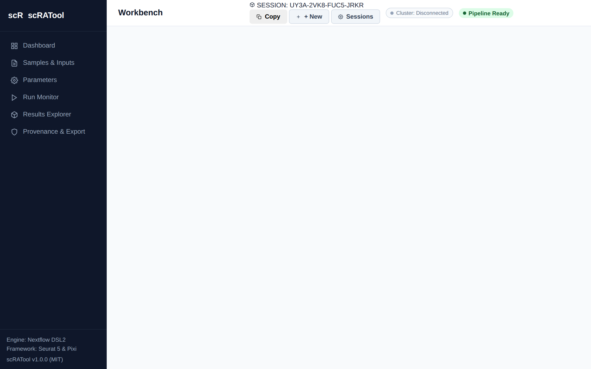
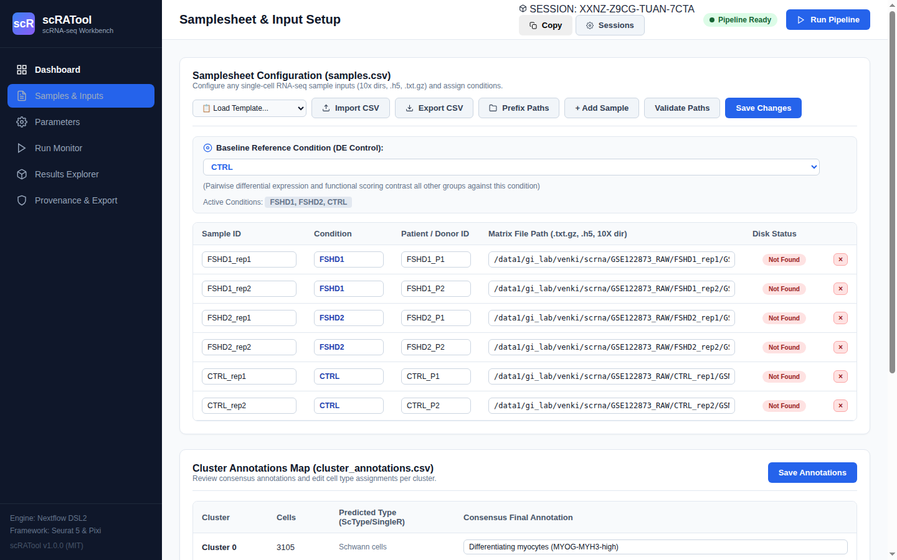
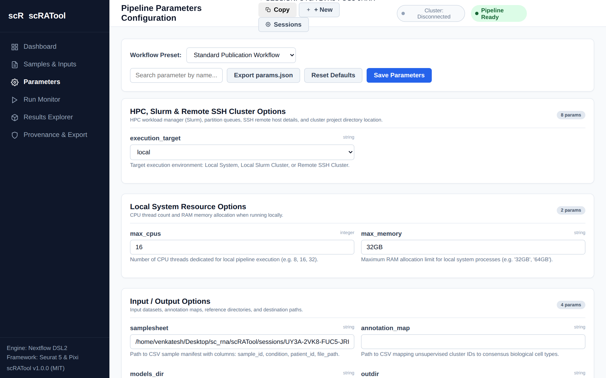
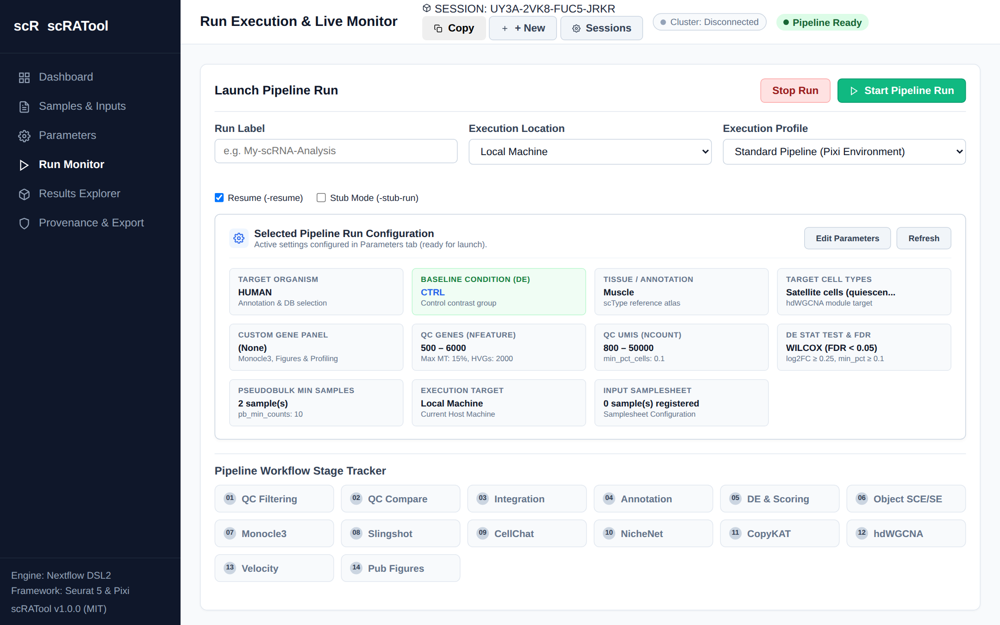
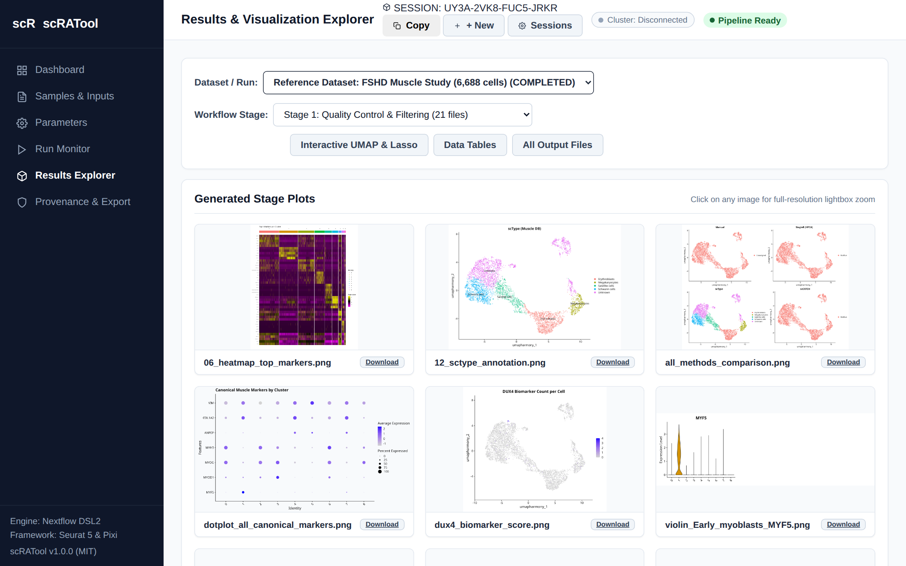
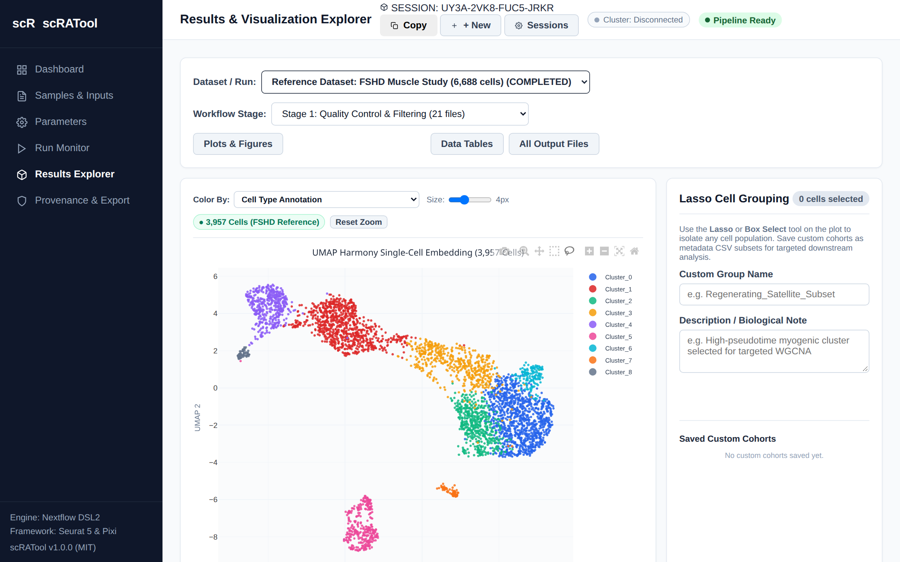

<div align="center">

# 🧬 scRATool
### Universal Single-Cell RNA Sequencing Downstream Analysis Platform
**Reproducible Nextflow DSL2 Workflow • Seurat v5 & Bioconductor Engine • Asynchronous FastAPI Web GUI**

[](https://github.com/VENKATESH-282/scRATool/releases)
[](https://www.nextflow.io/)
[](https://satijalab.org/seurat/)
[](https://bioconductor.org/)
[](https://fastapi.tiangolo.com/)
[](https://opensource.org/licenses/MIT)
[](https://www.python.org/)
[](https://www.r-project.org/)

<p align="center">
  <a href="#-quickstart-in-60-seconds">⚡ 60-Second Quickstart</a> •
  <a href="#-web-gui-tour--interactive-umap">🖥️ Web GUI Tour</a> •
  <a href="#-pipeline-architecture">🏛️ Architecture</a> •
  <a href="#-the-14-analysis-stages">🔬 14 Stages</a> •
  <a href="#-multi-method-benchmarking">📊 Benchmarking</a> •
  <a href="#-samplesheet--input-formats">📁 Data Inputs</a> •
  <a href="#-hpc-cluster--slurm-dispatch">🖥️ HPC Cluster</a> •
  <a href="#-in-depth-tutorials">📚 Tutorials</a>
</p>

---

</div>

## 📖 What is scRATool?

**scRATool** (*single-cell Reproducible Automated Tool*) is an end-to-end downstream analysis platform that automates the entire single-cell data science lifecycle. It integrates **14 modular analytical stages**—from raw count matrix decontamination through multi-method batch integration, consensus cell-type annotation, trajectory modeling, intercellular communication networks, and RNA velocity vector preparation—within a deterministic **Nextflow DSL2** engine.

### Why scRATool?
* **Zero Scripting for Biologists:** An interactive, browser-based graphical user interface (GUI) provides real-time stage monitoring, parameter configuration, high-resolution plot exploration, and an **interactive Plotly UMAP with Lasso/Box subpopulation selection** to dynamically isolate cell cohorts and export custom metadata.
* **Deterministic Rigour for Bioinformaticians:** Orchestrated via Nextflow DSL2 with built-in multi-method benchmarking (SoupX vs. DecontX, scDblFinder vs. DoubletFinder, Seurat CCA vs. RPCA vs. Harmony vs. FastMNN), multi-donor pseudo-bulk DESeq2 testing, automated checkpoint-and-resume caching (`-resume`), and multi-format object export (`.rds`, `.h5ad`, `SingleCellExperiment`, `Loom`).
* **Universal Matrix Ingestion:** Ingests 10x Genomics Cell Ranger directories, HDF5 (`.h5`, `.h5ad`), compressed tabular matrices (`.csv.gz`, `.tsv.gz`), serialized Seurat `.rds` objects, or remote NCBI GEO accessions directly over HTTPS.
* **Turnkey HPC Cluster Execution:** Built-in Paramiko SSH/SFTP profile manager connects to SLURM, SGE, or PBS clusters with visual directory browsing, automatic samplesheet synchronization, and detached background execution.

---

## ⚡ Quickstart in 60 Seconds

You can run scRATool either through the **interactive Web GUI** or headlessly via the **command line (CLI)**.

### Option 1: Launch the Interactive Web GUI (Recommended)

```bash
# 1. Clone the repository
git clone https://github.com/VENKATESH-282/scRATool.git
cd scRATool

# 2. Set up Python environment & dependencies
python3 -m venv venv
source venv/bin/activate
pip install -r requirements.txt

# 3. Launch the web application
./start.sh
```

Now open your browser and navigate to:
👉 **`http://localhost:8051`**

```text
================================================================================
  scRATool - Universal Single-Cell RNA-seq Analysis Platform
  Local URL:    http://localhost:8051
  Network URL:  http://127.0.0.1:8051
  Press Ctrl+C to stop the server.
================================================================================
```

---

### Option 2: Run Headlessly via Nextflow CLI

If you already have Nextflow and Pixi installed, run a test validation run in one command:

```bash
# Install bioinformatics environment via Pixi (one-time setup)
cd pipeline && pixi install && cd ..

# Run test profile using synthetic single-cell matrices
nextflow run pipeline/main.nf \
    -profile test,local,pixi \
    -resume
```

### Expected Terminal Output:
```text
================================================================================
  scRATool: Universal Single-Cell RNA-seq Analysis Platform (v1.0.0)
================================================================================
  Samplesheet      : assets/test_data/samples_test.csv
  Output Dir       : results_test/
  Organism         : human
  Ref Condition    : CTRL
  Profiles Active  : test,local,pixi
================================================================================

[01/14] STAGE_01_QC_FILTERING             [100%] 1 of 1 ✔
[02/14] STAGE_02_QC_TOOL_COMPARE          [100%] 1 of 1 ✔
[03/14] STAGE_03_INTEGRATION_CLUSTERING   [100%] 1 of 1 ✔
[04/14] STAGE_04_CELL_TYPE_ANNOTATION     [100%] 1 of 1 ✔
[05/14] STAGE_05_DIFFERENTIAL_EXPRESSION  [100%] 1 of 1 ✔
[06/14] STAGE_06_OBJECT_CONVERSION        [100%] 1 of 1 ✔
[07/14] STAGE_07_MONOCLE3_TRAJECTORY      [100%] 1 of 1 ✔
[08/14] STAGE_08_SLINGSHOT_LINEAGES       [100%] 1 of 1 ✔
[09/14] STAGE_09_CELLCHAT_COMMUNICATION   [100%] 1 of 1 ✔
[10/14] STAGE_10_NICHENET_SIGNALING       [100%] 1 of 1 ✔
[11/14] STAGE_11_COPYKAT_CNV              [100%] 1 of 1 ✔
[12/14] STAGE_12_HDWGCNA_NETWORKS         [100%] 1 of 1 ✔
[13/14] STAGE_13_VELOCITY_EXPORT          [100%] 1 of 1 ✔
[14/14] STAGE_14_PUBLICATION_FIGURES      [100%] 1 of 1 ✔

Pipeline execution completed successfully!
```

---

## 🏛️ Pipeline Architecture



---

## 🖥️ Web GUI Tour & Interactive UMAP

The scRATool web platform provides six dedicated views:

### 1. Workspace Session Manager
Switch between project workspaces instantly with **16-character session tokens** (e.g. `8CPN-MM8W-3A2Q-Z6U4`). Each workspace provides complete project isolation, cloned parameter state, and independent run histories.

<p align="center">
  
</p>

### 2. Samplesheet & Real-Time Path Validation
Manage your experimental cohort directly in an interactive spreadsheet editor:
* **Real-Time Path Existence Verification:** Displays live green status tags when `.h5`, `.txt.gz`, or Cell Ranger folders are detected on disk or cluster storage.
* **Bulk Directory Prefix Helper:** Prepend common cluster mount points (e.g., `/data/single_cell_runs/`) to relative sample paths in one click.
* **NCBI GEO Auto-Fetch:** Enter a GSE accession (e.g. `GSE174609`) to automatically query the NCBI FTP server, retrieve supplementary count matrices, and populate samplesheet rows.

<p align="center">
  
</p>

### 3. Dynamic Parameter Configuration
Every parameter across all 14 stages is dynamically rendered and validated against `nextflow_schema.json` (Draft-07 specification). Choose from 1-click biological presets:
* **Standard Publication Workflow**
* **Rapid Test / Stub Run**
* **Deep Discovery & Signaling**

<p align="center">
  
</p>

### 4. Run Monitor & Real-Time Log Streaming
Execute locally or dispatch to a remote SLURM cluster. Track stage progression through a live visual state tracker (Stages 01–14) with real-time Server-Sent Events (SSE) log streaming from `.nextflow.log`.

<p align="center">
  
</p>

### 5. Results Explorer & High-Resolution Lightbox
Browse outputs generated by every stage. Includes an image gallery with a **modal lightbox zoom** for reviewing publication-ready figures and searchable CSV data tables.

<p align="center">
  
</p>

### 6. Interactive Plotly UMAP with Lasso Sub-Clustering
Inspect single-cell embeddings colored by consensus cell types, conditions, or continuous biomarker expression:
* **Lasso & Box Selection:** Draw freely around any interesting cell population or transitional state.
* **Custom Cohort Export:** Give your selected cells a custom cohort name and biological description, then export them as targeted metadata CSV subsets (`assets/custom_groups/*.csv`) for focused downstream re-clustering or targeted WGCNA.

<p align="center">
  
</p>

---

## 🔬 The 14 Analysis Stages

| Stage | Module Name | Primary Objective | Algorithmic Tools | Published Outputs |
| :---: | :--- | :--- | :--- | :--- |
| **01** | **QC & Decontamination** | Ambient RNA correction, empty droplet separation, doublet scoring, adaptive MAD filtering | SoupX v1.6.2, DropletUtils v1.22, scDblFinder v1.16, Seurat v5.1 | Filtered Seurat objects, per-sample QC violin plots, filtering summary CSV |
| **02** | **QC Tool Comparison** | Empirical benchmarking of competing decontamination and doublet detection methodologies | Celda DecontX v1.14, DoubletFinder v2.0.4, scDblFinder v1.16 | Decontamination distributions, doublet caller concordance Venn diagrams |
| **03** | **Integration & Clustering** | Variance stabilization, multi-method batch correction, graph community detection | SCTransform v2, Seurat CCA/RPCA, Harmony v1.2, FastMNN, Louvain/Leiden | Integrated UMAPs, quantitative kBET mixing scores, batch/condition LISI metrics |
| **04** | **Cell-Type Annotation** | Triangulated reference- and marker-based annotation with consensus majority voting | SingleR v2.4, scType v1.1, scCATCH v3.2, celldex v1.12 | Consensus cell-type assignments, confidence distribution plots, cluster annotation CSV |
| **05** | **Differential Expression** | Multi-donor pseudo-bulk condition testing, cluster markers, functional GSEA | Seurat FindAllMarkers, DESeq2 v1.42, clusterProfiler v4.10, Enrichr | Pseudo-bulk DE tables, volcano plots, expression heatmaps, GO/KEGG dotplots |
| **06** | **Object Structures** | Cross-platform format serialization for seamless ecosystem interoperability | SingleCellExperiment v1.24, zellkonverter v1.12, SeuratDisk | Serialized Seurat RDS, Bioconductor SCE, AnnData (`.h5ad`), Loom format |
| **07** | **Monocle 3 Trajectory** | Manifold principal graph learning, root-to-terminal pseudotime, dynamic gene expression | Monocle 3 v1.3.4, `learn_graph`, `plot_cells` | Learned principal graph UMAP, pseudotime trajectory plots, kinetic branch curves |
| **08** | **Slingshot Lineages** | Simultaneous principal curve lineage inference, smooth generalized additive modeling | Slingshot v2.10, tradeSeq v1.16 (`fitGAM`, `associationTest`) | Slingshot lineage curves, pseudotime tables, smooth temporal expression heatmaps |
| **09** | **CellChat v2 Communication** | Mass-action cell-cell communication modeling, signaling pathway network topology | CellChat v2.1.2, CellChatDB.human / CellChatDB.mouse | Communication networks, interaction chord diagrams, signaling pathway circle plots |
| **10** | **NicheNet v2 Signaling** | Prior-model mechanistic ligand prioritization and downstream target gene regulation | NicheNet v2.0.6 (`nichenetr`), ligand-target matrix | Prioritized ligand activity heatmaps, ligand-target regulatory circus plots |
| **11** | **CopyKAT CNV Profiling** | Read-depth chromosomal copy-number alteration inference and aneuploid vs diploid typing | CopyKAT v1.1.0, Bayesian GMM clustering | Genomic CNV heatmaps, chromosome alteration profiles, diploid vs. aneuploid labels |
| **12** | **hdWGCNA Networks** | High-dimensional co-expression network analysis, metacell aggregation, hub gene detection | hdWGCNA v0.3.0, WGCNA v1.72 | Metacell Seurat object, co-expression module eigengenes, hub gene network graphs |
| **13** | **Velocity Input Export** | Extraction of spliced/unspliced count layers and cell embeddings for RNA velocity | Seurat v5, Matrix, Velocyto / scVelo export utilities | scVelo-compatible Loom/H5AD objects, spliced/unspliced count layers |
| **14** | **Publication Figures** | Automated assembly of composite, publication-ready multi-panel figures | ggplot2 v3.5, cowplot v1.1, patchwork v1.2, ragg | Composite multi-panel figures (300 DPI PNG & vector PDF), automated figure legends |

---

## 📊 Multi-Method Benchmarking

Unlike conventional "black box" pipelines, scRATool provides quantitative empirical comparisons:

### 1. Ambient RNA Removal: SoupX vs. DecontX
* **SoupX** models ambient contamination using empty droplets ($< 100$ UMIs) to calculate global contamination fraction $\rho$.
* **DecontX** uses a Bayesian mixture model to estimate per-cell contamination without requiring empty droplets.
* **Benchmark Output:** Stage 02 outputs a Pearson correlation scatterplot (`decontx_vs_soupx_scatter.png`) comparing both estimators per cluster.

### 2. Doublet Scoring: scDblFinder vs. DoubletFinder
* **scDblFinder** simulates synthetic doublets and trains an iterative gradient-boosted classifier.
* **DoubletFinder** generates artificial doublets ($pN$) and scores cells by proportion of artificial nearest neighbors ($pANN$).
* **Benchmark Output:** Stage 02 computes a concordance Venn diagram (`doublet_callers_concordance.png`) and purges consensus doublets.

### 3. Batch Integration: CCA vs. RPCA vs. Harmony vs. FastMNN
Stage 03 evaluates normalized embeddings against two quantitative metrics:
* **kBET (k-nearest neighbor Batch Effect Test):** Rejection rate measuring local batch mixing (lower = superior mixing).
* **LISI (Local Inverse Simpson's Index):** Evaluates batch diversity (iLISI) while preserving cell-type separation (cLISI).
* The top-performing integration is automatically selected and passed to Stage 04.

---

## 📁 Samplesheet & Input Formats

scRATool accepts count matrices across **five flexible entry modes**:

```csv
sample_id,condition,patient_id,file_path
Sample_CTRL_1,Control,Donor_A,data/10x_runs/CTRL_1/outs/filtered_feature_bc_matrix/
Sample_CTRL_2,Control,Donor_B,data/CTRL_2.h5
Sample_TREATED_1,Treated,Donor_C,data/TREATED_1.csv.gz
Sample_TREATED_2,Treated,Donor_D,https://ftp.ncbi.nlm.nih.gov/geo/series/GSE117nnn/GSE117988/suppl/GSE117988_raw.csv.gz
```

* **10x Chromium Outs Directory:** Folder containing `matrix.mtx.gz`, `barcodes.tsv.gz`, and `features.tsv.gz`.
* **HDF5 Matrices:** Standard `.h5` or `.h5ad` files.
* **Compressed Tables:** `.txt.gz`, `.csv.gz`, or `.tsv.gz` (genes as rows, cell barcodes as columns).
* **Pre-Built Objects:** Serialized `.rds` Seurat objects.
* **Remote NCBI GEO:** Direct HTTPS/FTP URL or GEO accession identifier.

---

## 🖥️ HPC Cluster & SLURM Dispatch

You can dispatch scRATool jobs to any HPC cluster (SLURM, SGE, PBS) directly through the web GUI:

1. In the **Run Monitor** view, switch **Execution Target** to **Remote HPC Cluster**.
2. Click **+ Add Profile** and enter your cluster connection parameters:
   * **Host:** `cluster.institution.edu`
   * **Port:** `22`
   * **User:** `your_username`
   * **Authentication:** Password or Private Key Path
3. Click **Test & Connect**. scRATool verifies the remote Nextflow and Pixi environment.
4. Set your remote scratch directory (e.g. `/scratch/users/username/scratool_run`).
5. Click **Launch Remote Pipeline**. The job is submitted to your cluster's SLURM queue and execution logs stream live to your browser. You can safely close your browser or turn off your laptop—the job continues running autonomously on the cluster.

---

## 📚 In-Depth Tutorials

Explore our dedicated, step-by-step guides covering every facet of single-cell analysis:

* 📖 **[Tutorial 1: Quickstart with 10x Genomics PBMC Data](tutorials/01_quickstart_pbmc3k.md)** — Complete hands-on tutorial using real PBMC count matrices, from download to publication figures.
* 🖥️ **[Tutorial 2: Web GUI Walkthrough & Interactive UMAP Manual](tutorials/02_gui_walkthrough.md)** — Visual tour of workspace session tokens, samplesheet builder, live SSE terminal, and Plotly lasso sub-clustering.
* 📋 **[Tutorial 3: Samplesheet & Biological Metadata Guide](tutorials/03_samplesheet_guide.md)** — Comprehensive guide to 10x directories, H5 files, compressed CSVs, and multi-donor experimental designs.
* 🚀 **[Tutorial 4: Enterprise HPC & SLURM Deployment](tutorials/04_hpc_slurm_guide.md)** — Remote SSH/SFTP architecture, cluster profiles, memory escalation on OOM, and headless execution.
* 🔬 **[Tutorial 5: QC Decontamination & Batch Integration Benchmarking](tutorials/05_qc_and_benchmarking.md)** — SoupX vs DecontX ambient RNA correction, doublet detection, and quantitative kBET/LISI evaluation.
* 🏷️ **[Tutorial 6: Consensus Cell Typing & Pseudo-bulk Differential Expression](tutorials/06_annotation_and_differential_expression.md)** — Triangulated annotation (SingleR + scType + scCATCH) and avoiding single-cell pseudoreplication with DESeq2.
* 🛤️ **[Tutorial 7: Trajectories, Intercellular Signaling & Gene Networks](tutorials/07_advanced_trajectories_and_signaling.md)** — Monocle 3, Slingshot, CellChat v2, NicheNet v2, CopyKAT CNV, and hdWGCNA co-expression networks.
* 🛡️ **[Tutorial 8: Custom Organisms, Tissues & Allowlist Biomarker Rescue](tutorials/08_custom_biology_and_allowlists.md)** — Analyzing Mouse/non-human datasets and preserving ultra-rare disease biomarkers from being discarded during QC.

---

## 📂 Repository Directory Structure

```text
scRATool/
├── app/                              # FastAPI asynchronous web application backend
│   ├── main.py                       # Server entrypoint and API router mounting
│   ├── config.py                     # Global configuration and path discovery
│   ├── db.py                         # SQLite database initialization
│   ├── runner.py                     # Local Nextflow subprocess management
│   ├── remote_runner.py              # Remote HPC Nextflow execution manager
│   ├── remote/                       # SSH/SFTP connection and file management
│   └── routers/                      # REST API endpoints (sessions, samples, params, logs)
├── pipeline/                         # Deterministic Nextflow DSL2 engine
│   ├── main.nf                       # Master pipeline orchestrator (Stages 01–14)
│   ├── nextflow.config               # Engine configuration and execution profiles
│   ├── pixi.toml                     # Declarative R 4.4 & Bioconductor lockfile
│   ├── bin/                          # 14 modular R analysis scripts (Stages 01–14)
│   ├── conf/                         # Resource profiles (base.config, cluster.config, test.config)
│   └── assets/                       # Test datasets and canonical reference dictionaries
├── static/                           # Web GUI frontend assets (CSS, JS, Plotly vendor)
├── templates/                        # Jinja2 HTML single-page application
├── tutorials/                        # In-depth, tutorial-grade documentation guides (01–08)
├── screenshots/                      # High-resolution application screenshots and previews
├── start.sh                          # One-click startup launcher script
├── requirements.txt                  # Python web dependencies
└── nextflow_schema.json              # Draft-07 JSON schema for automated parameter validation
```

---

## 🛠️ Frequently Asked Questions & Troubleshooting

<details>
<summary><b>1. How does Checkpoint-and-Resume (-resume) work?</b></summary>

Nextflow hashes all stage inputs, code scripts, and parameters into a unique signature. If a pipeline run is interrupted or if you modify parameters in Stage 07, running with `-resume` (enabled by default in the GUI) instantly retrieves cached results from Stages 01–06 without re-computing them, reducing turnaround time by over 90%.
</details>

<details>
<summary><b>2. How can I scale to massive datasets (>100,000 cells)?</b></summary>

For massive datasets, activate the `cluster` profile in `pipeline/conf/cluster.config`. Nextflow's automatic retry strategy catches Out-Of-Memory signals (Exit code 137 or 247) and dynamically doubles the requested memory before re-submitting the job to the SLURM queue.
</details>

<details>
<summary><b>3. Can I run scRATool on macOS or Windows?</b></summary>

* **macOS:** Fully supported on both Apple Silicon (M1/M2/M3) and Intel via Pixi.
* **Windows:** Fully supported via Windows Subsystem for Linux 2 (WSL2 Ubuntu 22.04+).
</details>

<details>
<summary><b>4. How do I cite scRATool in my research?</b></summary>

Please see the [Citation](#-citation) section below.
</details>

---

## 📄 License

This project is licensed under the **MIT License** - see the [LICENSE](LICENSE) file for details.

---

## ✉️ Citation

If you use scRATool in your research, please cite:

```bibtex
@article{scRATool2026,
  title={scRATool: A Nextflow DSL2-Orchestrated Universal Single-Cell RNA Sequencing Platform with Multi-Method Benchmarking and Interactive Web Analytics},
  author={Venkatesh, et al.},
  journal={bioRxiv / Journal of Bioinformatics},
  year={2026},
  doi={10.1101/2026.scratool}
}
```
