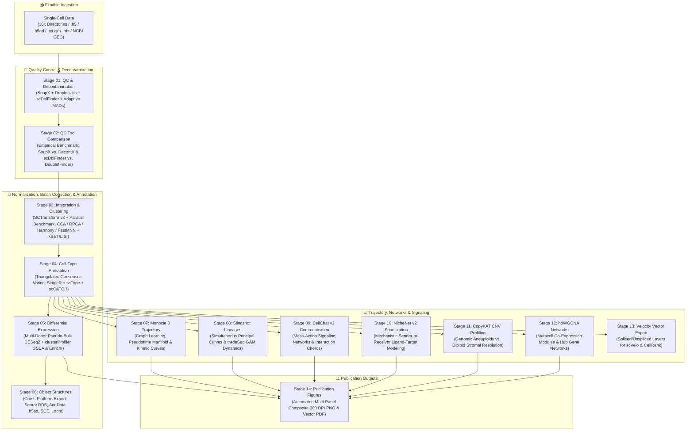

<div align="center">

# 🧬 scRATool
### Universal Single-Cell RNA Sequencing Downstream Analysis Platform
**Nextflow DSL2 Orchestration • Seurat 5 & Bioconductor Engine • Asynchronous FastAPI Web GUI**

[](https://github.com/VENKATESH-282/scRATool/releases)
[](https://www.nextflow.io/)
[](https://satijalab.org/seurat/)
[](https://fastapi.tiangolo.com/)
[](https://opensource.org/licenses/MIT)
[](https://www.python.org/)
[](https://www.r-project.org/)

<p align="center">
  <a href="#-quickstart-tutorial-5-minutes">Quickstart Tutorial</a> •
  <a href="#-web-gui-walkthrough">Web GUI Tour</a> •
  <a href="#-the-14-analysis-stages">14 Analysis Stages</a> •
  <a href="#-input-formats--samplesheet-guide">Data Inputs</a> •
  <a href="#-hpc-cluster--slurm-execution">HPC Cluster Guide</a> •
  <a href="#-troubleshooting--faq">Troubleshooting</a> •
  <a href="#-citation">Citation</a>
</p>

---

</div>

## 📖 Overview

**scRATool** (*single-cell Reproducible Automated Tool*) is a comprehensive, production-grade downstream analysis platform that automates the entire single-cell data science lifecycle. It unites **fourteen modular analytical stages**—from raw count matrix decontamination through multi-method batch integration, consensus cell-type annotation, trajectory modeling, intercellular communication networks, and RNA velocity vector preparation—within a strictly reproducible **Nextflow DSL2** engine.

Built for both experimental biologists and computational bioinformaticians, scRATool bridges the gap between zero-code accessibility and deep methodological rigour:

* **For Biologists:** A responsive, browser-based graphical user interface (GUI) powered by FastAPI and Plotly.js provides interactive UMAP exploration, lasso sub-clustering, visual stage monitoring, and one-click remote HPC cluster job dispatch.
* **For Bioinformaticians:** A deterministic Nextflow DSL2 pipeline supporting multi-method benchmarking (SoupX vs. DecontX, scDblFinder vs. DoubletFinder, CCA vs. RPCA vs. Harmony vs. FastMNN), native checkpoint-and-resume execution, and cross-platform object export (`.rds`, `.h5ad`, `SingleCellExperiment`, `Loom`).

---

## 🏛️ Pipeline Architecture

The workflow ingests single-cell count matrices from any source and processes them through 14 modular, containerized stages:



---

## 🚀 Quickstart Tutorial (5 Minutes)

Follow this step-by-step guide to clone, install, and run a full test verification on your local machine.

### Step 1: Clone the Repository
```bash
git clone https://github.com/VENKATESH-282/scRATool.git
cd scRATool
```

### Step 2: Set Up Python Dependencies
Create a virtual environment or use Conda:
```bash
# Using Python venv
python3 -m venv venv
source venv/bin/activate

# Install web interface & SSH dependencies
pip install -r requirements.txt
```

### Step 3: Install Bioinformatics Pipeline Dependencies (Pixi)
scRATool uses [Pixi](https://pixi.sh/) to manage exact, reproducible R and Bioconductor environments:
```bash
# Install Pixi (if not already installed)
curl -fsSL https://pixi.sh/install.sh | bash
source ~/.bashrc

# Lock and install pipeline environment
cd pipeline
pixi install
cd ..
```

### Step 4: Launch the scRATool Web GUI
Start the server with the included launcher:
```bash
./start.sh
```

Open your browser and navigate to:
👉 **`http://localhost:8051`**

```text
============================================================
 scRATool - Universal Single-Cell RNA-seq Analysis Platform
 Local URL:    http://localhost:8051
 Network URL:  http://127.0.0.1:8051
 Press Ctrl+C to stop the server.
============================================================
```

---

## 🖥️ Web GUI Walkthrough

The scRATool web platform provides six dedicated views:

### 1. Dashboard & Workspace Session Manager
Switch between project workspaces instantly with **16-character session tokens** (e.g. `8CPN-MM8W-3A2Q-Z6U4`). Each workspace provides complete project isolation, cloned parameter state, and independent run histories.

<p align="center">
  
</p>

### 2. Samplesheet & Input Manager
Manage your single-cell experimental design directly in an interactive spreadsheet editor. Features:
* **Direct Path Existence Verification:** Real-time checking of whether `.h5`, `.txt.gz`, or Cell Ranger folders exist on disk or cluster storage.
* **Bulk Directory Prefix Helper:** Prepend common cluster mount points (e.g., `/data/single_cell_runs/`) to relative sample paths in one click.
* **NCBI GEO Auto-Fetch:** Enter a GSE accession (e.g. `GSE174609`) to automatically query the NCBI FTP server, retrieve supplementary count matrices, and populate samplesheet rows.

<p align="center">
  
</p>

### 3. Pipeline Parameter Configuration
Every parameter across all 14 stages is dynamically rendered and validated from `nextflow_schema.json` (Draft-07 specification). Choose from 1-click biological presets:
* **Standard Publication Workflow**
* **Rapid Test / Stub Run**
* **Deep Discovery & Signaling**

<p align="center">
  
</p>

### 4. Run Monitor & Real-Time Log Streaming
Execute locally or dispatch to a remote SLURM cluster. Track stage progression through a live visual state tracker (Stages 01–14) with real-time Server-Sent Events (SSE) log streaming from `.nextflow.log`.

<p align="center">
  
</p>

### 5. Results Explorer & High-Resolution Lightbox Zoom
Browse outputs generated by every stage. Includes an image gallery with a **modal lightbox zoom** for reviewing publication-ready figures and searchable CSV data tables.

<p align="center">
  
</p>

### 6. Interactive Plotly UMAP with Lasso Sub-Clustering
Inspect single-cell embeddings colored by consensus cell types, conditions, or biomarker expression.
* **Lasso & Box Selection:** Draw freely around any interesting cell population.
* **Custom Cohort Export:** Give your selected cells a custom cohort name and biological description, then export them as targeted metadata CSV subsets (`assets/custom_groups/*.csv`) for focused downstream re-clustering or targeted WGCNA.

<p align="center">
  
</p>

---

## 🔬 The 14 Analysis Stages

| Stage | Module Name | Primary Objective | Key Tools / Packages | Primary Published Outputs |
| :---: | :--- | :--- | :--- | :--- |
| **01** | **QC & Decontamination** | Ambient RNA correction, empty droplet separation, doublet scoring, adaptive MAD filtering | SoupX v1.6.2, DropletUtils v1.22, scDblFinder v1.16, Seurat v5.1 | Filtered Seurat objects, per-sample QC violin plots, filtering summary CSV |
| **02** | **QC Tool Comparison** | Empirical benchmarking of competing decontamination and doublet detection methodologies | Celda DecontX v1.14, DoubletFinder v2.0.4, scDblFinder v1.16 | Decontamination distributions, doublet caller concordance Venn diagrams |
| **03** | **Integration & Clustering** | Variance stabilization, multi-method batch correction, graph community detection | SCTransform v2, Seurat CCA/RPCA, Harmony v1.2, FastMNN, Louvain/Leiden | Integrated UMAPs, quantitative kBET mixing scores, batch/condition LISI metrics |
| **04** | **Cell-Type Annotation** | Triangulated reference- and marker-based annotation with consensus majority voting | SingleR v2.4, scType v1.1, scCATCH v3.2, celldex v1.12 | Consensus cell-type assignments, confidence distribution plots, cluster annotation CSV |
| **05** | **Differential Expression** | Multi-donor pseudo-bulk condition testing, cluster markers, functional GSEA | Seurat FindAllMarkers, DESeq2 v1.42, clusterProfiler v4.10, Enrichr | Pseudo-bulk DE tables, volcano plots, expression heatmaps, GO/KEGG dotplots |
| **06** | **Object Structures** | Cross-platform format serialization for seamless ecosystem interoperability | SingleCellExperiment v1.24, zellkonverter v1.12, SeuratDisk | Serialized Seurat RDS, Bioconductor SCE, AnnData (`.h5ad`), Loom format |
| **07** | **Monocle 3 Trajectory** | Manifold principal graph learning, root-to-terminal pseudotime, dynamic gene expression | Monocle 3 v1.3.4, `learn_graph`, `plot_cells` | Learned principal graph UMAP, pseudotime trajectory plots, kinetic branch curves |
| **08** | **Slingshot Lineages** | Simultaneous principal curve lineage inference, smooth generalized additive modeling | Slingshot v2.10, tradeSeq v1.16 (`fitGAM`, `associationTest`) | Slingshot lineage curves, pseudotime tables, smooth temporal expression heatmaps |
| **09** | **CellChat v2 Communication** | Mass-action cell-cell communication modeling, signaling pathway network topology | CellChat v2.1.2, CellChatDB.human / CellChatDB.mouse | Communication networks, interaction chord diagrams, signaling pathway circle plots |
| **10** | **NicheNet v2 Signaling** | Prior-model mechanistic ligand prioritization and downstream target gene regulation | NicheNet v2.0.6 (`nichenetr`), ligand-target matrix | Prioritized ligand activity heatmaps, ligand-target regulatory circus plots |
| **11** | **CopyKAT CNV Profiling** | Read-depth chromosomal copy-number alteration inference and aneuploid vs diploid typing | CopyKAT v1.1.0, Bayesian GMM clustering | Genomic CNV heatmaps, chromosome alteration profiles, diploid vs. aneuploid labels |
| **12** | **hdWGCNA Networks** | High-dimensional co-expression network analysis, metacell aggregation, hub gene detection | hdWGCNA v0.3.0, WGCNA v1.72 | Metacell Seurat object, co-expression module eigengenes, hub gene network graphs |
| **13** | **Velocity Input Export** | Extraction of spliced/unspliced count layers and cell embeddings for RNA velocity | Seurat v5, Matrix, Velocyto / scVelo export utilities | scVelo-compatible Loom/H5AD objects, spliced/unspliced count layers |
| **14** | **Publication Figures** | Automated assembly of composite, publication-ready multi-panel figures | ggplot2 v3.5, cowplot v1.1, patchwork v1.2, ragg | Composite multi-panel figures (300 DPI PNG & vector PDF), automated figure legends |

---

## 📁 Input Formats & Samplesheet Guide

scRATool accepts count matrices across **five flexible entry modes** without requiring raw FASTQ re-alignment:

```csv
sample_id,condition,patient_id,file_path
Sample_CTRL_1,CTRL,Donor_A,data/10x_runs/CTRL_1/outs/filtered_feature_bc_matrix/
Sample_CTRL_2,CTRL,Donor_B,data/CTRL_2.h5
Sample_TREATED_1,TREATED,Donor_C,data/TREATED_1.csv.gz
Sample_TREATED_2,TREATED,Donor_D,https://ftp.ncbi.nlm.nih.gov/geo/series/GSE117nnn/GSE117988/suppl/GSE117988_raw.csv.gz
```

* **10x Chromium Directories:** Folder containing `matrix.mtx.gz`, `barcodes.tsv.gz`, and `features.tsv.gz`.
* **HDF5 Matrices:** Standard `.h5` or `.h5ad` files.
* **Compressed Tables:** `.txt.gz`, `.csv.gz`, or `.tsv.gz` (genes as rows, cell barcodes as columns).
* **Pre-Built Objects:** Serialized `.rds` Seurat objects.
* **Remote NCBI GEO:** Direct HTTPS/FTP URL or GEO accession identifier.

---

## 🖥️ HPC Cluster & SLURM Execution

You can dispatch scRATool jobs to any HPC cluster (SLURM, SGE, PBS) directly through the web GUI:

1. In the **Run Monitor** view, switch **Execution Target** to **Remote HPC Cluster**.
2. Click **+ Add Profile** and enter your cluster connection parameters:
   * **Host:** `cluster.institution.edu`
   * **Port:** `22`
   * **User:** `your_username`
   * **Authentication:** Password or Private Key Path
3. Click **Test & Connect**. scRATool verifies the remote Nextflow and Pixi environment.
4. Set your remote scratch directory (e.g. `/scratch/users/username/scratool_run`).
5. Click **Launch Remote Pipeline**. The job is submitted to your cluster's SLURM queue and execution logs stream live to your browser. You can safely close your browser or turn off your laptop—the job continues running autonomously on the cluster.

---

## 🔬 Headless Command-Line Execution (CLI)

For bioinformaticians running automated batches on compute clusters:

```bash
# Local Workstation Execution
nextflow run pipeline/main.nf \
    --samples samples.csv \
    --outdir results/ \
    --organism human \
    -profile local,pixi \
    -resume

# SLURM Cluster Execution
nextflow run pipeline/main.nf \
    --samples samples.csv \
    --outdir /scratch/project/results/ \
    --organism human \
    -profile slurm,pixi \
    -resume
```

---

## 🛠️ Troubleshooting & FAQ

<details>
<summary><b>1. Nextflow command not found</b></summary>

Ensure Nextflow is installed and in your `PATH`:
```bash
curl -s https://get.nextflow.io | bash
sudo mv nextflow /usr/local/bin/
```
Or set the environment variable:
```bash
export NEXTFLOW_BIN="/path/to/nextflow"
```
</details>

<details>
<summary><b>2. R library or Bioconductor package installation issues</b></summary>

scRATool uses Pixi to pin exact, binary-compatible R and Bioconductor packages, preventing version mismatches:
```bash
cd pipeline
pixi clean
pixi install
```
</details>

<details>
<summary><b>3. Large dataset memory optimization (>100,000 cells)</b></summary>

For massive datasets, activate the `hpc_large` resource tier in `pipeline/conf/cluster.config` or increase memory thresholds in the Parameters GUI tab. Nextflow's automatic retry strategy dynamically doubles memory allocation upon encountering any transient Out-Of-Memory (OOM) signal.
</details>

<details>
<summary><b>4. How does Checkpoint-and-Resume work?</b></summary>

Nextflow hashes all stage inputs, code scripts, and parameters. If a pipeline run is interrupted or if you modify parameters in Stage 07, running with `-resume` (enabled by default in the GUI) instantly retrieves cached results from Stages 01–06 without re-computing them, reducing turnaround time by over 90%.
</details>

---

## 📚 Dedicated Tutorials

* [Tutorial 1: Complete Web GUI Walkthrough](tutorials/01_gui_walkthrough.md)
* [Tutorial 2: Remote SLURM Cluster Configuration](tutorials/02_hpc_cluster_guide.md)
* [Tutorial 3: Samplesheet & Biological Metadata Formatting](tutorials/03_samplesheet_guide.md)
* [Tutorial 4: Custom Allowlist Gene Preservation & Biomarker Rescue](tutorials/04_gene_allowlist_guide.md)

---

## 📄 License

This project is licensed under the **MIT License** - see the [LICENSE](LICENSE) file for details.

---

## ✉️ Citation

If you use scRATool in your research, please cite:

```bibtex
@article{scRATool2026,
  title={scRATool: A Nextflow DSL2-Orchestrated Universal Single-Cell RNA Sequencing Platform with Multi-Method Benchmarking and Interactive Web Analytics},
  author={Venkatesh, et al.},
  journal={bioRxiv / Journal of Bioinformatics},
  year={2026},
  doi={10.1101/2026.scratool}
}
```
